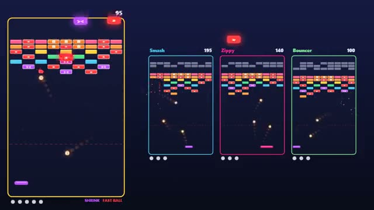

# Brick Duel

Break bricks to wreck your rivals' boards. A multiplayer starter game from [Multiplayer Agent](https://multiplayeragent.com): 2D, versus, 2–4 players, with bots that fill empty seats.

## How it plays

Everyone plays their own brick breaker side by side. Smash a glowing brick to hit a rival with a faster ball, a smaller paddle or junk rows. Lose all your balls and you're out; last board standing wins.

**Controls:** Mouse or ← → to move, click or Space to launch; on touch, drag to move and tap to launch.

## Make it yours in the Game Builder

Open the [Game Builder](https://multiplayeragent.com), choose **Start from a starter game** and pick Brick Duel. It opens as version 1 in your studio, ready to play and publish. Then ask for changes, for example:

- Add a laser power-up that shoots bricks
- Let me pick which rival my attacks hit
- Make the bricks candy and the ball a gumball

## Run it yourself

1. Get a free publishable key (`pk_…`) at [multiplayeragent.com](https://multiplayeragent.com).
2. In `index.html`, put it in place of `pk_REPLACE_ME` in the `MP_CONNECT` block.
3. Open `index.html` in a browser. No build step and no server needed.

Without a key it still runs, offline against bots.

## How it is built

- One `index.html`. The comment at the top of the script maps the code and explains the multiplayer.
- **Live sync:** You watch every rival's board, ball and paddle as they play.
- **Host-run rounds:** The host's browser runs the match: who is out, the winner, the restart, and which rival each attack hits. If it leaves, the next player takes over.
- **Bots:** Bots fill empty seats, play their own boards and send attacks too.
- **Leaderboard:** Each player's best match score.
- `?attract` runs it offline with bots only. The preview video is recorded from it.

## License

MIT.
